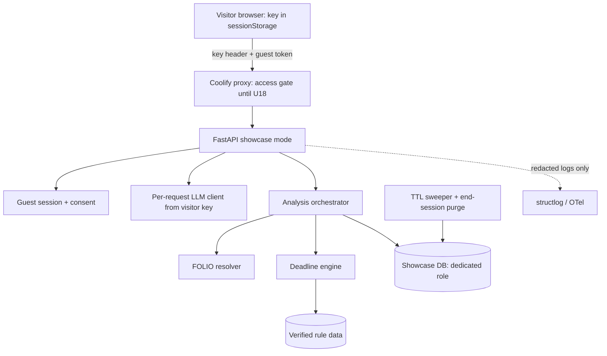
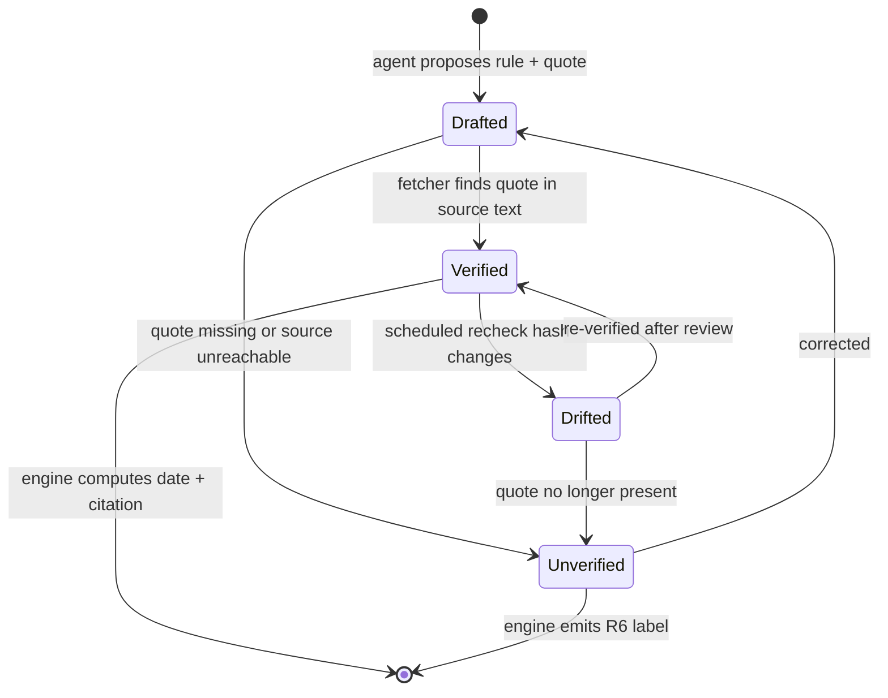

# alea-intake Public Showcase on openlegalstandard.org - Plan

## Goal Capsule

- **Objective:** A visitor who opens the intake showcase from `openlegalstandard.org/intake` can describe a legal situation, or pick a curated example, and get an analysis that finds every relevant legal issue, links claims and elements to their facts, maps them to FOLIO concepts, and computes cited deadlines for their state. The analysis must be good enough to put in public under FOLIO's name.
- **Means:** a showcase mode of the existing app, deployed with Coolify on hetzner-dev (KTD1), with deadlines rebuilt as verified rule data (KTD5).
- **Product authority:** Damien Riehl (ALEA Institute). The audience and launch bar were chosen in dialogue on 2026-11-08. The legal-aid professional and public self-help audiences are later milestones and are not active scope. Product Contract R-IDs win on behavior; KTDs win on mechanism.
- **Execution profile:** Deep. Ships as three PRs (see Implementation Units). Implementation fans out to Codex workers through `agents/worker-wrapper.sh`; the orchestrator verifies every artifact itself.
- **Stop conditions:** stop and ask Damien if the showcase cannot fit hetzner-dev without a paid server (spend), or if any change would need credentials or access not already held.
- **Open blockers:** None. Damien's approval of the landing-page copy gates the PR3 merge (Open Questions).
- **Who finishes:** the agent, through merge, Coolify deploy, the launch campaign, and the landing page, under Damien's standing push, merge, and deploy authorization.
- **Product Contract preservation:** changed: R5 scope narrowed by R23 and R21–R22 added at Damien's direction on 2026-11-08 (Minnesota first; regression and UAT throughout); Problem Frame corrected from evidence (round 7 passed across five deploys, not one run). No other behavior changed.

---

## Product Contract

### Summary

Launch alea-intake as a public, no-login FOLIO showcase. A landing page at `openlegalstandard.org/intake` introduces it, and the app runs at `intake.dev.openlegalstandard.org`. Visitors bring their own LLM key, and nothing they enter is kept. The site goes public only after all 8 persona tests pass every gate in the locked rubric, and only with correct, primary-source-cited deadlines or a plain "no verified rule" label for each state.

### Problem Frame

openlegalstandard.org is FOLIO's public home, and `mapper.` and `enrich.openlegalstandard.org` already show FOLIO at work. Nothing there yet shows FOLIO's hardest job: turning someone's messy story into a complete map of legal issues, including the ones the person never mentioned.

alea-intake does that job, but it has no running deployment. The Railway dev server was drained on 2026-07-26 and now returns "Application not found." Its last persona campaign (`docs/evidence/persona-campaign/pack.html`, rubric `intake-quality-v1.3`, round 7 on 2026-07-11) recorded all 8 personas passing. But those verdicts came from five different Railway deploys running a server-side gpt-4o-mini key, so no single run on a production stack has ever passed. Earlier rounds failed on the deadline engine (BUG-12) and on missed legal issues (GATE-01). Deadlines are computed and cited only for Minnesota plus a few federal and generic rules. The browser frontend has never run an analysis end to end; past campaigns drove the API directly.

Three decisions Damien made on 2026-07-26 were never carried out. All three change the output the persona tests measure, so they need to land before the persona tests run again.

A showcase that misses an issue or states a wrong deadline with confidence would damage FOLIO's credibility more than having no showcase at all.

### Key Decisions

- **Audience is a FOLIO showcase.** Visitors are legal technologists, legal aid organizations, and FOLIO adopters exploring what FOLIO-powered intake can do. (session-settled: user-directed — chosen over legal-aid professionals, public self-help, and showcase-then-pros: it is the lowest-risk audience and the fastest path to launch.) Governs R8, R10.
- **Hold the launch until every gate passes.** (session-settled: user-directed — chosen over "fix issues and label deadlines," "ship now and iterate live," and "curated scenarios only": Damien chose the strictest bar, "Let's get this right.") Governs R1, R2, R3, R4, R5, R6, R7.
- **Curated scenarios and free-text input both launch.** Damien named both, so neither waits for the other. Governs R13, R14.
- **Minnesota first, then other states in waves.** Launch needs verified Minnesota and federal rules; every other state shows the R6 label until its rules are verified. (session-settled: user-directed — chosen over all 50 states before launch: "We can start with Minnesota Law, expanding to others.") Governs R5, R6, R23.
- **Regression and UAT run throughout, not only at the end.** (session-settled: user-directed — chosen over a single pre-launch campaign: "We need this to be bulletproof.") Governs R21, R22.
- **Visitors bring their own LLM key, with no accounts and no retention.** This matches mapper and enrich and removes server-side AI cost and key-drain risk. Governs R9, R11, R15.
- **Host only on access we already have.** The app runs on the hetzner-dev box through Coolify, under the existing `*.dev.openlegalstandard.org` wildcard, and the landing page ships through the site repo's existing push-to-deploy. A path proxy at `openlegalstandard.org/intake` would need AWS Amplify console access, and a new subdomain would need Route 53 access; both belong to Mike. (session-settled: user-directed — chosen over the ALEA EC2 host and a new `intake.` record: "so we don't have to bug Mike.") Governs R19, R20.
- **The decisions already answered land first.** Calibration (q1, q2), the expansion-vocabulary calibration (q3), and the PyMuPDF replacement were decided on 2026-07-26 and change what the gates measure. Governs R16, R17, R18.

### Actors

- A1. Visitor: a legal technologist, legal aid staffer, or FOLIO adopter using the public site with their own LLM key.
- A2. Persona campaign: the 8 scripted personas plus the rubric judge. Together they set the launch gate.
- A3. Damien: product authority.

### Requirements

**Launch quality gate**

- R1. The site goes public only after all 8 personas pass every gate in `intake-quality-v1.3` and its practice-area addenda in one campaign run. The 8 personas are landlord-tenant, immigration, family-custody, wage-theft, benefits-denial, employment-discrimination, consumer-debt, and elder-exploitation.
- R2. The launch campaign runs against the production stack, with the same build and configuration that will serve the public.
- R3. Gates are judged on one reference model, and the UI recommends that same model to visitors.
- R4. The issue-completeness gates (GATE-01 and each addendum's issue-spotting gates) pass for every persona, including issues the persona never names.

**Deadlines**

- R5. Each deadline shown is computed to a specific date for the client's actual state and cited to that state's primary source: a statute, regulation, court rule, local rule, or standing order. Immigration deadlines cite federal authority instead, per the immigration addendum.
- R6. When the tool has no verified rule for a deadline in the client's state, it says so plainly and points the visitor to where to check. It never estimates, and it never applies another state's rule.
- R7. A rule counts as verified only after its citation has been checked against the primary source text. Unverified rules fall under R6.

**Deadline coverage**

- R23. At launch, Minnesota and federal deadline rules for the 8 covered matter types are verified. Other states show the R6 label until their rules are verified in later waves.

**Regression and UAT**

- R21. Every PR runs a regression suite that replays fixed persona and user-story inputs and fails on any lost issue, FOLIO concept, deadline, or citation against the last accepted baseline.
- R22. Before launch, browser UAT on the production stack covers the 8 personas plus a user-story matrix beyond them: multi-issue, sparse or vague, out-of-state, emergency-safety, lapsed-deadline, document-upload, missing-key, and other-model stories.

**Showcase experience**

- R8. The site presents itself as a FOLIO demonstration and says on every page that it is not legal advice.
- R9. Visitors supply their own LLM API key. The server never uses a key of its own to serve a request.
- R10. No account or login is required, and the SSO, case-management connectors, admin, and multi-tenant surfaces stay hidden.
- R11. Nothing a visitor enters, including their story, documents, results, and key, is kept after the session ends. Application logs and error reports count.
- R12. Visitors can see the full analysis: issues, claims and elements linked to their facts, FOLIO concepts with resolvable IRIs, deadlines, the visualizations, and an exportable memo.
- R13. Visitors can start from curated example scenarios, each of which passes the gates under R1.
- R14. Visitors can describe their own situation in free text or upload a document.
- R15. When the visitor uses a model other than the reference model, the UI says that quality is verified only on the reference model.

**Prerequisite cleanup (already decided)**

- R16. The calibration operating point (`SINGLE_STAGE_PENALTY` 0.85, `confidence_threshold` 0.55) and the "floor" combine rule are adopted, per `alea-intake-2026-07-24-calibration` q1 and q2.
- R17. The expansion-vocabulary calibration runs, and any operating point it recommends goes to Damien before adoption, per q3.
- R18. PyMuPDF (AGPL) is removed from the shipped product, with no loss in PDF heading or provenance extraction, per `portfolio-2026-07-24-license-sweep` q1. The README and THIRD-PARTY files no longer list it as an open question.

**Hosting and entry point**

- R19. The app is served at `intake.dev.openlegalstandard.org` and stays unlisted and access-gated until the R1 gate passes.
- R20. A page at `openlegalstandard.org/intake` introduces the showcase, states that it is a demonstration and not legal advice, and launches the app. It appears in the site's Tools menu alongside Enrich and Mapper.

### Key Flows

- F1. Curated example
  - **Trigger:** A1 opens the site and picks an example scenario.
  - **Steps:** The visitor enters their own key, the analysis runs with progress shown, results appear in each view, and the visitor exports the memo.
  - **Covered by:** R8, R9, R12, R13
- F2. Visitor's own situation
  - **Trigger:** A1 types their own story or uploads a document.
  - **Steps:** Same as F1. Deadlines show a computed, cited date or the R6 "no verified rule" message. When the session ends, nothing is kept.
  - **Covered by:** R5, R6, R11, R14, R15
- F3. Launch gate
  - **Trigger:** R16–R18 have landed and the production stack is up.
  - **Steps:** A2 runs all 8 personas on the production stack with the reference model, and the judge scores them under v1.3. Every failure is fixed and the full campaign reruns until one run passes every gate. Then the access gate comes off and the landing page ships.
  - **Covered by:** R1, R2, R3, R4, R19, R20

### Acceptance Examples

- AE1. **Covers R5, R6.** Given a free-text visitor in a state where the eviction-answer rule is verified, the tool shows the computed answer date and cites the rule. Given the same facts in a state whose rule has not passed verification, it shows "no verified rule for your state" with a pointer to the court self-help center, and no date.
- AE2. **Covers R6.** Given a family-custody story set in Wisconsin, no Minnesota answer period appears anywhere in the output.
- AE3. **Covers R9.** Given a visitor who has not entered a key, analysis does not start, and the server makes no LLM call.
- AE4. **Covers R11.** Given a finished session, neither the database nor the application logs nor any error report holds the visitor's story text or key.
- AE5. **Covers R1.** Given a campaign where 7 personas pass and one fails a single gate, the site stays private.
- AE6. **Covers R15.** Given a visitor whose key is for a model other than the reference model, a notice says quality is verified only on the reference model, and the analysis still runs.

### Success Criteria

- One campaign run on the production stack scores every gate as passing for all 8 personas, and it is recorded as a new evidence pack revision linked from `EVIDENCE.md`.
- `https://openlegalstandard.org/intake` launches the app at `https://intake.dev.openlegalstandard.org/`, and a real browser run of F1 and F2 completes there.
- Every shown deadline in that campaign has a citation that resolves to the primary source text.
- Every story in the R22 matrix passes browser UAT on the production stack, and the R21 regression suite is green on the launch commit.

### Scope Boundaries

**Deferred for later**

- Verified deadline rules for states beyond Minnesota, added in post-launch waves (R23).

- Accounts, saved intakes, and organization workspaces for legal aid professionals (the next audience milestone).
- Public self-help positioning aimed at people seeking help with their own legal problem.
- Voice input. It needs its own speech-to-text key and privacy review.
- Practice areas beyond the 8 the personas cover.
- Exposing case-management connectors (Clio, MyCase, LegalServer) and autonomy or approval modes.

**Outside this product's identity**

- Legal advice or attorney-client relationships.
- A server-paid free tier of LLM usage.

**Considered and not built**

- A SQLite database on tmpfs: KTD3 weighs it, and Postgres wins on concurrency and single-dialect parity.
- An audit trail of purges: no requirement needs one, and a retention test proves the purge.

### Deferred to Follow-Up Work

- Deadline rule waves for other states (R23), starting with states whose legislatures publish structured text (Virginia, Utah, New York, Michigan, California, Iowa).

### Dependencies / Assumptions

- Hosting follows the folio-insights pattern: Coolify on hetzner-dev under `*.dev.openlegalstandard.org` (`folio-insights/docs/deploying.md`). The wildcard already resolves `intake.dev.openlegalstandard.org` to that box.
- hetzner-dev is shared and tight: on 2026-11-08 `free -m` showed 7.5 GB RAM with 1.7 GB available, its 4 GB swap fully used, and 86% disk use. If alea-intake will not fit, a larger box is spend, which needs Damien's approval.
- The landing page ships through the `openlegalstandard.org` repo, where a push to `main` triggers the Amplify deploy. Another session is building that repo's Tools showcase (`feat/folio-tools-showcase`), so the intake page coordinates with it. Damien line-edits the page copy before it ships, per that repo's copy rule.
- Primary-source verification is agent-performed: fetch and check each citation, then run a judging pass. Damien does not review rules one by one.
- All 8 personas are Minnesota cases (`docs/evidence/persona-campaign/personas/ANSWER-KEYS.md`), so the R1 gate cannot test other states. The R22 matrix covers out-of-state behavior.
- Rubric `intake-quality-v1.3` stays locked. Its RUB-08 fails any required deadline not computed to a date; that bar applies to the Minnesota personas, while out-of-state stories are judged against R6.
- The reference model is cheap enough that visitors with their own keys will accept the cost of a typical intake.

### Sources / Research

- `docs/evidence/persona-campaign/pack.html` and `manifest.json`: every campaign round (22 pass, 3 borderline, 10 fail summed across rounds 1–7; round 7 alone records all 8 personas passing).
- `docs/rubrics/intake-quality-v1.3.md` and `docs/rubrics/practice-areas/`: the locked rubric and its addenda.
- `docs/plans/deadline-detection-v1.md`: the deadline engine framework and the 50-state scaling notes.
- `docs/plans/2026-07-11-round7-expansion-domain-rules.md`: the last round of quality work.
- `docs/solutions/2026-07-07-pdf-agpl-swap-and-folio-python-resolve.md`: why pdfplumber over pypdf.
- `docs/solutions/live-validation-unit-green-integration-dead.md`: passing unit tests did not prove the live system worked.
- Commit `1e3af71` (calibration study) and branch `feat/s075.4-pymupdf-to-pdfplumber` (commit `980c255`).
- BYOK pattern: folio-enrich `docs/HANDOFF-2026-06-28-byok-prod-deploy-DONE.md`.
- Hosting pattern: folio-insights `docs/deploying.md` (Coolify on hetzner-dev); `openlegalstandard.org` `docs/plans/2026-11-07-0913-feat-folio-tools-showcase-plan.md` (Amplify deploy, Tools menu).

---

## Planning Contract

### Key Technical Decisions

- KTD1. **Coolify app on hetzner-dev, one container.** FastAPI serves the built SPA and `/health`, following `folio-insights/docs/deploying.md`. Set the domain through Coolify's `domains` field, give the healthcheck a 30 s start period with 15 retries (the app takes about 90 s to boot), set a container memory limit, and keep one build at a time. Governs R19.
- KTD2. **A CPU-only, slimmed image.** `uv.lock` currently pulls CUDA torch plus 15 nvidia packages (5.2 GB environment). Resolve torch from the CPU wheel index, or replace sentence-transformers with an ONNX MiniLM provider if CPU torch still will not fit. The memory budget is measured, not assumed: hetzner-dev showed 1.7 GB available with its 4 GB swap fully used on 2026-11-08. If the measured footprint plus headroom exceeds that, stop per the Goal Capsule.
- KTD3. **Postgres, on the box's existing pgvector/PG17 instance, in a dedicated database and role.** Weighed against SQLite:

  | Factor | Postgres (chosen) | SQLite |
  |---|---|---|
  | Extra RAM | None: reuses the running `postgres` container | None |
  | Concurrent public users | Row-level locking; analyses run minutes inside a request | One writer at a time; long async transactions block other sessions |
  | Code path | Hardened in Phase 14 (NullPool, tz-aware timestamps, public-schema routing) | SQLite-first originally, but a second dialect to keep green |
  | Future legal-aid milestone | Same engine as accounts and retention later | Would need a migration |
  | Vector search | pgvector available | None |
  | Retention proof | Needs an explicit purge (KTD4) | Also needs a purge; tmpfs helps but loses on restart mid-session |

  Postgres wins on concurrency and single-dialect parity, which matter more than SQLite's simplicity for a public multi-user site. The showcase database gets its own role with no access to other apps' databases, and it is excluded from any backup job. Governs R11.
- KTD4. **Retention is a session-scoped purge, not a mode flag.** `ALEA_PERSISTENCE_MODE` is never read and `PersistenceManager.handle_session_complete` has no callers, so the existing "ephemeral" mode does nothing. Every row and file an intake creates hangs off one showcase session. A purge deletes the session's whole graph (messages, facts, analysis, deadlines, outputs, uploaded files, audit rows) when the visitor ends the session, and a sweeper deletes any session idle past a short TTL. Logging redacts narrative text and keys at the structlog processor and OTel attribute level, and error reports scrub request bodies. Governs R11.
- KTD5. **Deadline rules become verified data.** Rules move from Python lambdas (`backend/app/services/deadline/rules.py`, 15 rules) to data records. Each record holds the trigger event, count (fixed, or event-supplied with a verified default), unit (hours, calendar days, court days, business days, or years), cap, direction, per-record roll rule taken from the cited source, service add-on, holiday calendar, jurisdiction, matter type, citation, source URL, exact supporting quote, as-of date, and a SHA-256 of the normalized source text. A second, document-sourced class covers dates the client's own papers state (a hearing date on a summons or notice to appear): it computes the stated date, cites the document plus the procedural authority (for example 8 CFR 1003.18 or Minn. Stat. 504B.321), and verifies only that procedural citation. Contractual or practical dates (a severance deadline, a bank's window) render as "stated in your document, not a legal deadline," never with the R6 label. The schema starts from `docs/plans/deadline-detection-v1.md` and borrows lexdays' design (rule packs with test cases, refuse-to-guess on unverified holiday years), but not its AGPL code. Governs R5, R6, R7, R23.
- KTD6. **Verification is mechanical, then judged.** A rule is verified only when all three hold:
  1. A fetcher retrieves the primary source, and the stored quote appears in its normalized section text.
  2. The count and unit parsed from the quote equal the record's count and unit fields.
  3. A recorded judging pass (an independent agent review) confirms the trigger event, direction, roll rule, service add-on, and applicability against the quote.

  Sources:
  - **Minnesota statutes and court rules:** revisor.mn.gov, which hosts both.
  - **Federal regulations:** the eCFR versioner API (no key needed).
  - **Federal statutes:** uscode.house.gov.
  - **Recheck:** a scheduled job refetches each source, hashes the normalized section text (not the whole page), and reports any drift without auto-editing rules.

  Governs R7.
- KTD7. **State detection is explicit.** Replace the substring `_is_mn()` check (`rules.py:51`) with a jurisdiction value resolved from extracted facts, defaulting to "unknown" (which yields R6 output). The EEOC charge rule also collects city, discrimination basis, and employer size. Governs R5, R6.
- KTD8. **BYOK is request-scoped.** The visitor's key travels with each request and WebSocket session in memory only, is never written to the database or logs, and builds a per-request LLM client. Remove every ambient fallback: the alea-llm-client env and `~/.alea/keys` lookup, the zero-argument `LLMService()` constructions (`routers/analysis.py:71,359`, `routers/output.py:155`), the five stages that build their own provider maps, and any LLM the folio-python library builds from server env (its `folio/graph.py`, unused today because no caller passes `llm_model`). A missing key returns a clean 400 before any LLM call. No secret ever travels in a URL: REST calls carry the key in a request header, and the WebSocket authenticates with a first message carrying the guest token and key, closing with 4001 if it does not arrive promptly. Uvicorn's access log is disabled or routed through the redaction processor, and the proxy logs no query strings. This follows folio-enrich's key-drain hardening. Governs R9, R15.
- KTD9. **Showcase mode is one env flag.** It mints a throwaway guest identity per browser session (reusing the existing auth and consent plumbing), records consent from a click-through notice, and leaves the admin, SSO, CMS, autonomy, and organization routers unmounted. Every mounted intake, analysis, output, document, consent, end-session, and WebSocket route resolves its intake or session and returns 404 unless the requesting guest owns it; today `list_intakes` filters only by organization, so all guests would otherwise see each other's intakes. Governs R8, R10, R11.
- KTD10. **Pre-launch access gate at the proxy.** Until U18, Coolify's proxy requires a shared preview credential stored on the box by location, so the app is reachable for UAT but not public. Removing it is a config change. Governs R19.
- KTD11. **Three-layer verification.** Every PR runs unit and integration tests plus the regression replay (U9). PR2 and PR3 add live persona runs on the gated deployment. The launch adds the full browser UAT matrix (U16). Judging follows the round-3 adjudication rules: evidence comes only from the current run's artifacts, FOLIO matches are checked by resolving the IRI, and the deterministic checks (`folio_check.py`, `memo_checks.py`, export integrity, deadlines against the answer key) always run. Governs R1, R2, R21, R22.

### High-Level Technical Design

Request path in showcase mode:

Deadline rule lifecycle:

Verification layers per PR:

| Layer | PR1 | PR2 | PR3 |
|---|---|---|---|
| Unit + integration (pytest, vitest) | yes | yes | yes |
| Regression replay vs baseline (U9) | yes | yes | yes |
| Live personas on gated deploy (U11) | smoke | full 8 | full 8, one run |
| Browser UAT matrix (U16) | flow smoke | full | full, launch record |

### Assumptions

- The visitor-recommended reference model is chosen in U11 by measured gate pass rate and cost per intake among a few current low-cost models; gpt-4o-mini is the historical baseline.
- A short idle TTL (on the order of an hour) is acceptable to visitors; planning leaves the exact value to U7.
- `python-holidays` (MIT) is acceptable as a vetted, pinned dependency for holiday calendars, logged in `THIRD-PARTY.md`.

### Sequencing

Cleanup (U1–U3) lands first because it changes scores. The runtime units (U4–U8) and the regression harness (U9) build in parallel. Deployment (U10) and the persona harness (U11) follow. PR2's rule work (U12–U14) and state scoping (U15) can start once PR1 is built; they merge after PR1 is deployed. PR3 runs only after PR2 is deployed.

---

## Implementation Units

| U-ID | Title | Key files | Depends on |
|---|---|---|---|
| U1 | Adopt calibration operating point | `backend/app/services/folio/concept_resolver.py` | none |
| U2 | Expansion-vocabulary calibration study | `backend/migration/` sweep harness | U1 |
| U3 | Replace PyMuPDF with pdfplumber | `backend/app/services/document/extractors/pdf_extractor.py` | none |
| U4 | Slim CPU image and runtime footprint | `Dockerfile`, `backend/pyproject.toml` | none |
| U5 | Request-scoped BYOK and real chat replies | `backend/app/services/llm_service.py`, routers | none |
| U6 | Showcase mode and guest sessions | `backend/app/main.py`, auth | U5 |
| U7 | Session purge, TTL sweeper, log redaction | `backend/app/db/`, logging | U6 |
| U8 | Frontend showcase flow | `frontend/src/` | U5, U6 |
| U9 | Regression replay harness | `scripts/`, `backend/tests/regression/` | U1, U3 |
| U10 | Coolify deploy behind access gate | `Dockerfile`, `docs/DEV-DEPLOY-RUNBOOK.md` | U4, U7 |
| U11 | Persona harness on BYOK and guest | `scripts/persona_run.py` | U10 |
| U12 | Deadline rules as data | `backend/app/services/deadline/` | U5 |
| U13 | Primary-source fetch and verify | `scripts/rules/`, `backend/app/services/deadline/verify/` | U12 |
| U14 | Minnesota and federal rule set | `backend/data/deadline_rules/` | U12, U13 |
| U15 | State scoping and issue completeness | `backend/app/services/analysis/doctrine_probes.py` | U5 |
| U16 | User-story UAT matrix | `frontend/tests/e2e/`, `docs/evidence/persona-campaign/personas/stories/` | U8, U11 |
| U17 | Launch campaign to green | `docs/evidence/persona-campaign/` | U2, U14, U15, U16 |
| U18 | Lift the access gate | Coolify config | U17 |
| U19 | Landing page on openlegalstandard.org | site repo `src/pages/intake` | U17 |

### PR1: Cleanup and showcase runtime

Waits on: nothing.

### U1. Adopt calibration operating point

- **Goal:** Carry out `alea-intake-2026-07-24-calibration` q1 and q2.
- **Requirements:** R16.
- **Dependencies:** none.
- **Files:** `backend/app/services/folio/concept_resolver.py`, `backend/tests/test_concept_resolver.py`, `backend/tests/test_migration_sweep.py`, `backend/migration/sweep.py`.
- **Approach:**
  1. Resolve the folio-resolve drift: the lock resolves 0.2.0, the venv has 0.1.0, and the study ran on 0.1.0. Sync the venv to the lock and re-run the sweep there.
  2. If the sweep still recommends 0.85 / 0.55 plus the floor rule, adopt them. If not, keep the old values and report the new numbers to Damien before changing anything.
  3. Set `SINGLE_STAGE_PENALTY` to 0.85 and the threshold default to 0.55, and port the floor combine rule from `backend/migration/sweep.py:195-262`.
  4. Wire `ALEA_FOLIO_CONFIDENCE_THRESHOLD` to the resolver.
- **Patterns to follow:** the golden-baseline harness from commit `4c2a591`.
- **Test scenarios:**
  - A concept scored only by a single stage at 0.80 raw stays above threshold under 0.85 penalty and the floor rule.
  - A weighted combine that previously dipped below its best single signal now floors at it.
  - The env threshold, when set, overrides the 0.55 default.
  - The golden baseline set changes only where the study predicted.
- **Verification:** Sweep output on the locked folio-resolve matches the adopted values, and the backend suite passes.

### U2. Expansion-vocabulary calibration study

- **Goal:** Run the queued q3 study and put any recommended change to Damien.
- **Requirements:** R17.
- **Dependencies:** U1.
- **Files:** `backend/migration/sweep.py`, `backend/migration/sweep_gold.json`, `docs/evidence/calibration/`.
- **Approach:** Extend the sweep to the expansion vocabulary on top of U1's operating point. Publish the evidence and file a `cockpit-decide` ask if it recommends a change. Adopt nothing without his answer.
- **Test expectation:** none -- study only, no behavior change.
- **Verification:** The evidence file exists, and Damien's answer to the ask is recorded (or the study recommends no change) before U17 starts.

### U3. Replace PyMuPDF with pdfplumber

- **Goal:** Ship no AGPL code.
- **Requirements:** R18.
- **Dependencies:** none.
- **Files:** `backend/app/services/document/extractors/pdf_extractor.py`, `backend/app/services/document/document_service.py`, `backend/pyproject.toml`, `backend/uv.lock`, `THIRD-PARTY.md`, `THIRD_PARTY_LICENSES.md`, `README.md`, `backend/tests/test_pdf_extractor.py`.
- **Approach:** Bring `feat/s075.4-pymupdf-to-pdfplumber` (980c255) onto master. The only conflict is `THIRD-PARTY.md`. Then regenerate the lock, update the license files, and remove the README's open AGPL question.
- **Patterns to follow:** `docs/solutions/2026-07-07-pdf-agpl-swap-and-folio-python-resolve.md`.
- **Test scenarios:**
  - A PDF with a 18 pt title and 11 pt body yields one heading element and paragraph elements with page and bbox.
  - A scanned, text-free PDF falls through to OCR as before.
  - `pymupdf` and `fitz` appear nowhere in the lock or source.
- **Verification:** Extraction tests pass and the license audit lists no AGPL package.

### U4. Slim CPU image and runtime footprint

- **Goal:** An image that fits hetzner-dev.
- **Requirements:** R2, R19.
- **Dependencies:** none.
- **Files:** `Dockerfile`, `entrypoint.sh`, `backend/pyproject.toml`, `backend/uv.lock`, `backend/app/observability/health.py`.
- **Approach:**
  1. Apply KTD2's CPU-only resolution.
  2. Report the commit from a generic build arg instead of `RAILWAY_GIT_COMMIT_SHA`.
  3. Measure steady-state and peak RAM during a full persona analysis, and record the numbers in the runbook.
- **Execution note:** This is packaging; prove it with a built-image smoke run and a memory measurement, not unit tests.
- **Test scenarios:**
  - The built image boots, serves `/health` with the build commit, and completes one persona analysis.
  - The image contains no `nvidia-*` package.
- **Verification:** Measured peak RAM is recorded and fits KTD2's budget, or the run stops per the Goal Capsule.

### U5. Request-scoped BYOK and real chat replies

- **Goal:** Every LLM call uses the visitor's key, and chat answers for real.
- **Requirements:** R9, R14, R15; AE3, AE6.
- **Dependencies:** none.
- **Files:** `backend/app/services/llm_service.py`, `backend/app/routers/intake.py`, `backend/app/routers/analysis.py`, `backend/app/routers/output.py`, the five modules with their own provider maps (`backend/app/services/analysis/stages/issue_spot.py`, `explore.py`, `fact_map.py`, `deadline_detect.py`, `backend/app/services/extraction/fact_extraction.py`), `backend/app/services/folio/folio_service.py`, `backend/tests/test_byok.py`.
- **Approach:**
  1. Implement KTD8.
  2. Pass the request's LLM service into all four `ConversationService(...)` constructions (`routers/intake.py:405,627,851,947`).
  3. Return a reference-model flag the UI uses for R15.
- **Execution note:** Start with a failing test that sets a server env key, sends no visitor key, and asserts no outbound LLM call.
- **Test scenarios:**
  - Covers AE3. With `ALEA_LLM_API_KEY` and `OPENAI_API_KEY` set on the server and no visitor key, every analysis, chat, and output endpoint returns 400 and the LLM client is never constructed.
  - A visitor key reaches each of the five stages and the deadline detector (spy on the client factory).
  - Two concurrent sessions with different keys never cross keys.
  - The key never appears in captured logs or DB rows after a full run.
  - Covers AE6. A non-reference model returns the notice flag, and analysis still runs.
  - A chat turn returns a model-generated reply, not the static fallback.
- **Verification:** The no-ambient-key test passes, and a grep of the code finds no zero-argument LLM construction.

### U6. Showcase mode and guest sessions

- **Goal:** No-login use with only the showcase surfaces mounted.
- **Requirements:** R8, R10.
- **Dependencies:** U5.
- **Files:** `backend/app/main.py`, `backend/app/config.py`, `backend/app/routers/auth.py`, `backend/tests/test_showcase_mode.py`.
- **Approach:** Implement KTD9 and KTD8's no-secrets-in-URL rule. In showcase mode the WebSocket drops the `?token=` contract and authenticates with its first message, and checks ownership before accepting. Expose a disclaimer and consent text endpoint the UI renders.
- **Test scenarios:**
  - With showcase mode on, `/api/v1/admin`, SSO, CMS, autonomy, and organization routes return 404.
  - A new browser session receives a guest token and can run an intake after consent.
  - Without consent, intake creation is refused.
  - Guest B gets 404 on guest A's intake messages, results, audit, visualization, export, analyze, and end-session.
  - Guest B's WebSocket connect to guest A's session closes with 4003.
  - Guest A's intake does not appear in guest B's list.
  - A WebSocket that sends no auth message within the timeout closes with 4001.
  - With showcase mode off, existing auth tests still pass unchanged.
- **Verification:** Both modes' test suites pass.

### U7. Session purge, TTL sweeper, and log redaction

- **Goal:** Nothing a visitor enters survives the session.
- **Requirements:** R11; AE4.
- **Dependencies:** U6.
- **Files:** `backend/app/db/`, `backend/app/deployment/persistence.py`, `backend/app/observability/logging.py`, `backend/app/observability/telemetry.py`, `backend/tests/test_retention.py`.
- **Approach:** Implement KTD3 and KTD4. Map every table and upload path an intake touches, and give the purge one owner. Delete `PersistenceManager`'s dead 24-hour path, or route it through the purge.
- **Execution note:** Write the "seed a full intake, purge, assert zero rows in every table and no files" test first.
- **Test scenarios:**
  - Covers AE4. After a full intake with a PDF upload and an end-session call, every intake-linked table has zero rows for that session, and the upload directory is empty.
  - A session idle past the TTL is purged by the sweeper, and an active session is not.
  - A purge interrupted midway completes on the next sweep.
  - Captured structlog output, uvicorn access-log output, proxy-style request lines, OTel span attributes, and a forced 500's error report contain no narrative text, key, or guest token.
  - The showcase DB role cannot read another database on the instance.
- **Verification:** The retention test passes against real Postgres (Phase 14 found SQLite-only tests hid real bugs).

### U8. Frontend showcase flow

- **Goal:** A visitor can run F1 and F2 in the browser.
- **Requirements:** R8, R12, R13, R14, R15; F1, F2.
- **Dependencies:** U5, U6.
- **Files:** `frontend/src/api/`, `frontend/src/pages/`, `frontend/src/components/`, `frontend/src/i18n/`, `frontend/tests/`.
- **Approach:**
  1. Fix the client's calls to routes that do not exist (`/api/v1/intakes`, `/api/v1/outputs`, `/api/v1/intakes/{id}/safety`). Showcase mode makes no organization calls.
  2. Add key entry, kept in sessionStorage or memory only (never localStorage): a provider and model selector with the reference model preselected, inline format validation, a help link on getting a key and the typical cost per intake, a privacy line, and the R15 notice. Error states cover a rejected key, quota or rate limit, network drop, and mid-run failure, each with a retry that keeps the entered story.
  3. Add a curated-scenario picker seeded from the persona narratives.
  4. Add an analyze action with progress, wired to the existing views.
  5. Add a deadlines view. Each card shows the event, the computed date, how it was counted, the citation link, and the as-of date, with distinct treatments for computed, document-stated, contractual, lapsed, R6, and unknown-state deadlines. R6 cards point to a verified per-state self-help destination, with a generic fallback; that pointer table is rule-adjacent data U13 verifies.
  6. Add session lifecycle: an "End session and erase" control with confirmation, an idle warning before the TTL with "Export memo" and "Keep session" actions, and an expired-session screen that says the data was erased and offers a fresh start.
  7. Make the flow keyboard-operable, announce progress and errors in a live region, give each visualization a text or table alternative, and lay out cleanly at 390 px.
  8. Add the disclaimer banner, and hide login and admin.
  9. Apply the `frontend-design` skill.
- **Test scenarios:**
  - A curated scenario runs end to end against MSW mocks and renders issues, concepts, deadlines, and export.
  - A free-text story and a PDF upload each start an analysis.
  - Starting without a key shows the key prompt and sends no analysis request.
  - Reloading the tab keeps the key for the session; closing the browser forgets it.
  - The deadlines view renders a cited date and an R6 label from fixtures.
  - The disclaimer is present on every route.
  - A rejected key, a quota error, and a mid-run failure each show their message and a retry that keeps the story.
  - The idle warning appears before the TTL, and after expiry the expired-session screen replaces the views.
  - "End session and erase" purges the session and returns to a fresh start.
  - An axe accessibility check passes on each view, and no view scrolls horizontally at 390 px.
- **Verification:** vitest and the Playwright smoke pass, and a screenshot of each view is inspected.

### U9. Regression replay harness

- **Goal:** Catch quality loss on every PR.
- **Requirements:** R21.
- **Dependencies:** U1, U3.
- **Files:** `scripts/regression_replay.py`, `backend/tests/regression/`, `docs/evidence/regression/baseline/`.
- **Approach:**
  1. Replay the 8 persona narratives through the pipeline with recorded LLM responses, so CI is deterministic and costs $0. U16 adds each new story and its baseline entry through step 4's accept step.
  2. Key each recording by a hash of the stage's normalized prompt and model. A missing recording fails closed and names the stage, so a prompt-changing PR (such as U15) cannot pass on stale answers.
  3. Diff issues, FOLIO IRIs, deadlines, and citations against an accepted baseline.
  4. A prompt-changing PR re-records the affected stages with a live run on the operator's key against the gated deployment. A baseline changes only by an explicit accept step that records the prompt diff, the issue diff, and why.
- **Patterns to follow:** `backend/migration/` golden harness (PYTHONHASHSEED=0, offline).
- **Test scenarios:**
  - A seeded change that drops one issue from a persona fails the replay and names the issue.
  - A new extra concept is reported as an addition, not a failure.
  - An unchanged run passes in under a few minutes.
  - A changed probe prompt with no new recording fails and names the stage.
- **Verification:** The replay runs in CI on the PR1 branch and passes against the accepted baseline.

### U10. Coolify deploy behind access gate

- **Goal:** The gated showcase runs at `intake.dev.openlegalstandard.org`.
- **Requirements:** R2, R19.
- **Dependencies:** U4, U7.
- **Files:** `docs/DEV-DEPLOY-RUNBOOK.md` (rewritten for Coolify), `scripts/verify-showcase.sh`.
- **Approach:**
  1. Apply KTD1, KTD3, and KTD10.
  2. Create the dedicated database and role on the existing instance.
  3. Point the Coolify GitHub App at master, with no second deploy Action.
  4. Write `verify-showcase.sh`. It checks `/health` reports the deployed commit, that a no-key request returns 400, that a guest session works, that one guest cannot read another's intake, that the purge leaves zero rows, and that the gate blocks anonymous requests.
  5. Remove the Railway-era instructions and the committed smoke password from the runbook.
- **Execution note:** Smoke-first: the live probe script is the proof.
- **Test scenarios:**
  - `verify-showcase.sh` passes against the deployment.
  - A request without the preview credential is refused at the proxy.
- **Verification:** The probe passes, and hetzner-dev's other apps stay healthy after the deploy (check `docker ps` health and free memory).

### U11. Persona harness on BYOK and guest

- **Goal:** Live persona runs against the gated deployment, and the reference model is chosen.
- **Requirements:** R1, R2, R3.
- **Dependencies:** U10.
- **Files:** `scripts/persona_run.py`, `scripts/instant_on.sh`, `scripts/memo_checks.py`, `scripts/folio_check.py`, `docs/evidence/persona-campaign/`.
- **Approach:**
  1. Drive the guest flow with a supplied key, through the preview credential.
  2. Record the deploy commit with every run, so a campaign is provably one run on one build.
  3. Pin the judge model and prompt in the pack.
  4. Run all 8 personas on each candidate reference model, and pick by gate pass rate and cost per intake.
- **Test scenarios:**
  - A run against a deployment whose `/health` commit differs mid-campaign aborts.
  - `folio_check.py` resolves every IRI and fails on a substring-only match.
- **Verification:** One smoke campaign completes on the gated deployment, and the reference model and its evidence are recorded.

### PR2: Deadline rules and quality

Waits on: PR1, merge order for building (U12–U15 can start once PR1 is built), and PR1's deployment before merge: PR2's live persona and UAT verification runs on the deployed stack. Reason for a separate PR: PR2 cannot merge until PR1 is deployed, because its gate is measured on that deployment.

### U12. Deadline rules as data

- **Goal:** The engine computes from verified rule records.
- **Requirements:** R5, R6, R7, R23.
- **Dependencies:** U5.
- **Files:** `backend/app/services/deadline/rules.py`, `backend/app/services/deadline/engine.py`, `backend/app/services/deadline/schemas.py`, `backend/app/services/deadline/jurisdiction.py`, `backend/app/services/output/templates/deadlines.md.j2`, `backend/tests/test_deadline_engine.py`.
- **Approach:**
  1. Implement KTD5 and KTD7.
  2. Implement counting: exclude the trigger day, include the last day, apply each record's own roll rule (never a blanket roll), add the service add-ons, and count court days for short periods. Holiday calendars come from `python-holidays` plus Minnesota court closure dates.
  3. Migrate the 15 existing rules into records before deleting the lambdas.
  4. An unverified or missing rule yields the R6 output.
- **Execution note:** Characterize the current 15 rules' outputs first, then migrate, and confirm identical dates.
- **Test scenarios:**
  - A 14-day period from a Friday trigger that lands on Thanksgiving rolls to the next court day.
  - A service-by-mail rule adds its add-on days.
  - A Wisconsin custody fact pattern gets no Minnesota period (Covers AE2).
  - Covers AE1. A rule marked unverified yields the R6 label with a self-help pointer and no date.
  - An unknown jurisdiction yields R6 output, never a default state.
  - A holiday year with no verified calendar refuses to compute rather than guess.
  - All 15 migrated rules reproduce their pre-migration dates, except where a verified roll rule applies; each difference is listed.
  - The immigration persona's stated hearing date and the eviction persona's stated hearing date still compute, cited to the document and procedural authority.
  - A severance deadline from the client's papers renders as a contractual date, not as an R6 label.
  - The asylum one-year rule counts in years, and the Minn. Stat. 181.13 penalty clock counts in hours with its 15-day cap.
- **Verification:** Engine tests pass, and the memo template renders the citation on every computed deadline.

### U13. Primary-source fetch and verify

- **Goal:** A rule is marked verified only by machine check.
- **Requirements:** R7.
- **Dependencies:** U12.
- **Files:** `scripts/rules/verify_rules.py`, `backend/app/services/deadline/verify/fetchers/` (revisor_mn, ecfr, uscode), `backend/tests/test_rule_verify.py`, `.github/workflows/rule-drift.yml`.
- **Approach:** Implement KTD6. Fetched text is stored only as a hash plus the quote, not as a copy of the source. The drift workflow opens an issue on change.
- **Test scenarios:**
  - A rule whose quote "within 90 days" appears in the fetched 7 CFR 273.15 text is verified with its SHA-256 recorded.
  - A rule whose quote says "30 days" when the source says "90 days" is rejected.
  - A rule whose quote appears verbatim in the source but whose stored count differs from the quoted number is rejected.
  - A rule with no recorded judging pass stays unverified.
  - An unreachable source leaves the rule unverified, not verified.
  - A changed source hash is reported as drift and does not flip the rule silently.
- **Verification:** The verifier runs over the rule set, and its report lists every rule's status.

### U14. Minnesota and federal rule set

- **Goal:** Verified deadlines for all 8 matter types in Minnesota and federal law.
- **Requirements:** R5, R23.
- **Dependencies:** U12, U13.
- **Files:** `backend/data/deadline_rules/mn/`, `backend/data/deadline_rules/federal/`, `backend/tests/test_rule_set.py`.
- **Approach:** Codex workers draft the rules per matter type from each practice-area addendum's deadline section (`docs/rubrics/practice-areas/`). U13 verifies them, and only verified rules ship as verified. Federal rules cover immigration, benefits regulations, FLSA, FDCPA, and EEOC.
- **Test scenarios:**
  - Every deadline named in the Minnesota answer keys (`docs/evidence/persona-campaign/personas/ANSWER-KEYS.md`) has a verified rule, and the engine reproduces the key's date. Where a verified roll rule moves a key date (the FDCPA date falls on a Saturday, the EEOC date on a Sunday), a dated answer-key correction citing the source quote lands first.
  - No rule lacks a source URL, quote, or hash.
- **Verification:** The verifier reports 100% verified for rules the answer keys require.

### U15. State scoping and issue completeness

- **Goal:** No Minnesota law leaks into other states, and no persona misses an issue.
- **Requirements:** R4, R6; AE2.
- **Dependencies:** U5.
- **Files:** `backend/app/services/analysis/doctrine_probes.py`, `backend/app/services/exploration/engine.py`, `backend/app/services/analysis/stages/issue_spot.py`, `backend/tests/test_doctrine_probes.py`.
- **Approach:** Tag each of the 57 "Minn." probes with its jurisdiction, and fire state-specific probes only for that state, with state-neutral wording elsewhere. Close any GATE-01 misses that U11's live runs surface.
- **Test scenarios:**
  - A Wisconsin custody story triggers no probe citing Minnesota law.
  - A Minnesota custody story still triggers the Minnesota best-interests probe.
  - Each persona's answer-key issues all appear, including the unnamed ones.
- **Verification:** Probe tests pass, and the regression replay shows no lost issue.

### U16. User-story UAT matrix

- **Goal:** Browser UAT beyond the 8 personas.
- **Requirements:** R22; AE1, AE2, AE3, AE5, AE6.
- **Dependencies:** U8, U11.
- **Files:** `docs/evidence/persona-campaign/personas/stories/`, `frontend/tests/e2e/showcase.spec.ts`, `docs/evidence/uat/`.
- **Approach:** Write synthetic stories with answer keys for each R22 category, plus out-of-state variants of each persona. Run them through the real browser on the gated deployment with Playwright and judge them per KTD11.
- **Test scenarios:**
  - A multi-issue story (eviction plus wage theft) surfaces both issue sets.
  - A three-sentence vague story prompts clarifying questions rather than a confident analysis.
  - An out-of-state eviction shows R6 labels and no Minnesota citation (Covers AE1, AE2).
  - An emergency-safety story leads with safety framing.
  - A lapsed asylum one-year deadline is flagged as lapsed with routing.
  - A story submitted as an uploaded PDF (an eviction summons) surfaces the same issues and stated hearing date as the typed version.
  - A missing key blocks the start (Covers AE3).
  - A non-reference model shows the notice (Covers AE6).
  - Every story's export opens and matches the on-screen analysis.
- **Verification:** The matrix runs green on the gated deployment, with screenshots and verdicts in `docs/evidence/uat/`.

### PR3: Launch

Waits on: PR2, needed before this group can start: the launch campaign runs only on PR2's deployed stack. Reason for a separate PR: the campaign can run only in production, so the work that waits on its result ships after it.

### U17. Launch campaign to green

- **Goal:** One run on one build passes every gate.
- **Requirements:** R1, R2, R3, R4; F3; AE5.
- **Dependencies:** U2, U14, U15, U16.
- **Files:** `docs/evidence/persona-campaign/`, `EVIDENCE.md`.
- **Approach:** Run all 8 personas plus the U16 matrix on the reference model and one recorded commit. If any gate fails, fix forward through PR2-style changes and rerun the whole campaign. A rerun is allowed only after a recorded code or configuration change, never as a pure retry. The evidence pack records every campaign run made on the launch commit, with its gate results. Publish the new pack revision.
- **Test expectation:** none -- this unit is the verification itself.
- **Verification:** Every gate passes in one run on one commit, and `EVIDENCE.md` links the pack.

### U18. Lift the access gate

- **Goal:** The showcase is public.
- **Requirements:** R19.
- **Dependencies:** U17.
- **Files:** Coolify proxy configuration; `docs/DEV-DEPLOY-RUNBOOK.md`.
- **Approach:** Remove the KTD10 gate, then rerun `verify-showcase.sh` without the credential.
- **Test expectation:** none -- config change, proven by the live probe.
- **Verification:** Anonymous F1 and F2 pass in a real browser.

### U19. Landing page on openlegalstandard.org

- **Goal:** `openlegalstandard.org/intake` introduces and launches the showcase.
- **Requirements:** R8, R20.
- **Dependencies:** U17.
- **Target repo:** `openlegalstandard.org`.
- **Files:** `src/pages/intake.astro` (or the Tools-section equivalent from `feat/folio-tools-showcase`), the Tools menu entry, its Markdown twin, `tests/`.
- **Approach:**
  1. Draft the copy in a Claude Doc and wait for Damien's "done."
  2. Build the page within the tools-showcase structure (Tools menu, maturity badge, JSON-LD, Markdown twin) once that branch has merged, or coordinate through its plan.
  3. Push to `main`, and Amplify deploys it.
- **Test scenarios:**
  - The page renders, links to `https://intake.dev.openlegalstandard.org/`, and shows the not-legal-advice line.
  - It appears in the Tools menu.
  - It has no horizontal scroll at 390 px.
- **Verification:** The live page loads after the Amplify deploy, and its launch link opens the public showcase.

---

## Verification Contract

| Check | Command or surface | Applies to |
|---|---|---|
| Backend unit + integration | `cd backend && .venv/bin/pytest` | every unit with backend code |
| Retention against real Postgres | backend tests with a Postgres URL set | U7, U10 |
| Frontend unit | `cd frontend && npx vitest run` | U8 |
| Browser e2e | `cd frontend && npx playwright test --trace off` | U8, U16 |
| Regression replay | `scripts/regression_replay.py` vs `docs/evidence/regression/baseline/` | every PR (R21) |
| Rule verification | `scripts/rules/verify_rules.py` | U13, U14 |
| Live deployment probe | `scripts/verify-showcase.sh <url>` | U10, U18 |
| Live persona campaign | `backend/.venv/bin/python scripts/persona_run.py <persona_dir> <url>` | U11, U17 |
| License audit | no AGPL in `backend/uv.lock`; `THIRD-PARTY.md` current | U3, any new dependency |
| Visual check | screenshot of each changed view, inspected | U8, U19 |

---

## Definition of Done

- Every unit's Verification holds, and every test layer in the Verification Contract is green on the launch commit.
- The Success Criteria in the Product Contract hold.
- `verify-showcase.sh` passes anonymously against the public URL, and hetzner-dev's other services stay healthy.
- No server-side LLM key exists in the showcase's environment.
- The Railway-era runbooks and `.planning/STATE.md` no longer describe a Railway deployment.
- Code from abandoned approaches is removed from the diff.
- Browser pages, dev servers, and test containers started during the work are closed.

---

## Open Questions

- **Gate on the PR3 merge (U19):** Damien approves the landing-page copy in a Claude Doc before it ships.
- **Possible spend (U4):** if the measured footprint will not fit hetzner-dev, Damien decides on a larger server.
- **Spend: LLM key for live runs (U9, U11, U16, U17).** Showcase mode removes the server key, so persona campaigns, recordings, the reference-model bake-off, and UAT reruns need an operator key and budget. Damien chooses which key funds them and the ceiling.
- **Decision: visitor-visible state (U8, U12).** Recommended: show "State detected: X" with a confirm-or-choose control, because a vague story otherwise defaults to the R6 label even for a Minnesota visitor.
- **Deferred to implementation: court closure dates (U12).** Which primary source verifies Minnesota court closure days; the refuse-to-guess rule applies when a year cannot be verified.

### Review items awaiting approval

These came from an independent cross-model review only, so they wait for approval before they land:

- **Public abuse limits (U3, U6, U10).** Add upload byte and page limits, bounded PDF and OCR time, request body limits, capped concurrent analyses with a bounded queue, and per-guest and per-IP admission limits before expensive work. Without them one visitor can exhaust the shared box.
- **Candidate-commit verification (PR2).** Deploy PR2's candidate commit to the gated stack before merge, and require the live evidence to record that commit; otherwise PR2's live checks run against PR1's code.
- **Gated and public probe modes (U10, U18).** Give `verify-showcase.sh` a gated mode (anonymous rejected, credentialed works) and a public mode (anonymous guest flow works), since U18 reruns it without the credential.

---

## Appendix

### Planning Sources

- Codebase research findings: frontend route mismatches, canned chat, dead ephemeral mode, CUDA torch, Minnesota-only probes, folio-resolve drift (verified file pointers cited in the units above).
- `folio-insights/docs/deploying.md` (Coolify pattern); folio-enrich BYOK plan `docs/plans/2026-06-28-001-fix-byok-harden-public-key-drain-plan.md`.
- eCFR versioner API (verified live 2026-11-08 on 7 CFR 273.15 and 42 CFR 431.221); revisor.mn.gov (Minnesota statutes and court rules); lexdays rule-pack design (AGPL, design only).
- `docs/solutions/live-validation-unit-green-integration-dead.md`: passing unit tests did not prove the live system worked, which is why every PR also verifies live.
